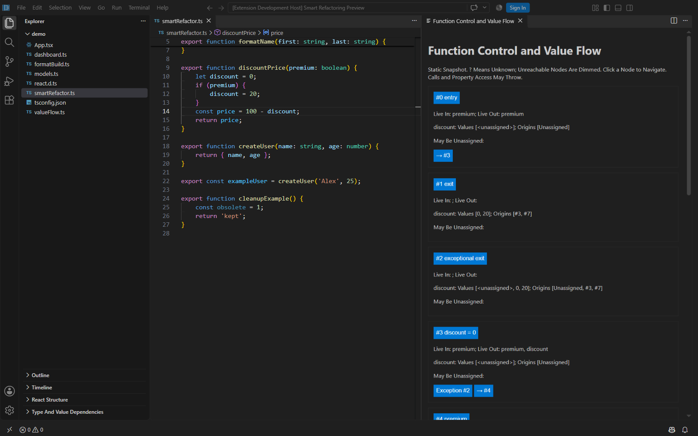
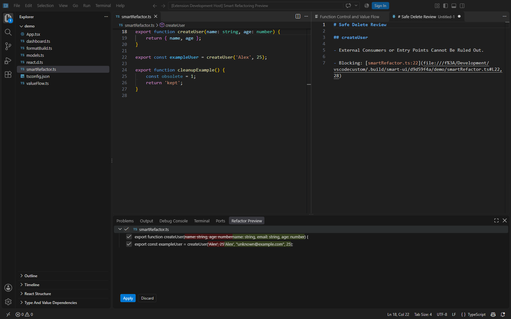

# Code OSS — Structural Tools

A custom Code OSS build with JetBrains-inspired tools for React and TypeScript. The built-in **TypeScript Structure Tools** extension adds extraction, rename previews, JSX navigation, refactorings across files, and dependency analysis.

[Testing walkthrough](docs/structural-tools/README.md) · [Release notes](docs/structural-tools/RELEASE_NOTES.md) · [Extension reference](extensions/structural-typescript/README.md)

## Smart Refactoring — 0.2.0

The shared TypeScript/JavaScript engine now also provides the four features in the [smart refactoring walkthrough](docs/structural-tools/SMART_REFACTOR.md):

| Feature | Try it |
| --- | --- |
| Advanced Intention Actions | Press `Ctrl+.` for 13 supported, validated transformations. |
| Function Data Flow | Run **Analyze Function Control and Value Flow** for a navigable CFG with reaching assignments, liveness, possible constants/null states, and unassigned reads. |
| Safe Delete | Run **Safe Delete Symbol** or **Safe Delete File** for blocking usages, removable imports, uncertainty reports, and guarded deletion previews. |
| Change Signature | Run **Change Signature and Update Callers** to edit parameters and migrate supported callers, overloads, constructors, and interface implementations. |

Use [smartRefactor.ts](docs/structural-tools/demo/smartRefactor.ts) to test these commands. Supported syntax is deliberately bounded; unsafe or ambiguous cases are refused. Build the standalone VSIX with `node scripts/package-structural-extension.mts`, then use **Install from VSIX**. The earlier Windows installer contains the 0.1.0 preview; install the 0.2.0 VSIX to test these additions.





## Structural Tools Preview

This fork adds four JetBrains-inspired feature areas to Code OSS: React extraction and rename previews, JSX structure and breadcrumbs, refactorings that update callers across files, and type/value dependency analysis. These are an initial TypeScript/JavaScript implementation with conservative safety checks. CSS/HTML text matches are optional search results; this is not a shared AST for every language.

Open the [sample folder](docs/structural-tools/demo) in the custom build, then open the Command Palette (`Ctrl+Shift+P`) and search **TypeScript Structure**. No sample dependencies need installing. Follow the [illustrated testing walkthrough](docs/structural-tools/README.md) for exact selections, commands, expected results, and limitations.

### React Structure and breadcrumbs

Open `App.tsx`, expand **React Structure** in Explorer, and click the `<li>` entry. Hooks, conditional JSX, and `.map()` iterations appear in the tree and breadcrumb ancestry.


### Extract React Component

Select the complete `<section>…</section>` in `App.tsx`, run **Extract React Component**, and enter `CounterPanel`. Review the new props interface, import, and replacement JSX. Select the edits you approve in **Refactor Preview** before applying them.


### Refactor across files

Place the cursor in `formatBuild` in `formatBuild.ts` and run **Extract Parameter Object and Update Callers**. The preview includes an options interface and both calls in `dashboard.ts`.


### Type dependency analysis

Click the `OwnedBuild` identifier in `models.ts`, run **Show Type Dependencies**, and expand the tree. It connects the intersection's `BuildJob` and `Owner` types, including `BuildJob`'s parent `Job`.


The [walkthrough](docs/structural-tools/README.md) also covers rename modes, reverse parameter conversion, member movement, and possible value flow. Read the [release notes](docs/structural-tools/RELEASE_NOTES.md) for this installation. The [extension reference](extensions/structural-typescript/README.md) documents supported syntax, analysis limits, validation, and Windows installer builds.

## Build the Windows installer

On Windows x64, install the Node version specified in [.nvmrc](.nvmrc), Visual Studio's **Desktop development with C++** workload, and a Windows SDK. From the repository root, run:

```powershell
./scripts/build-structural-installer.ps1
```

The script validates the extension, packages Code OSS, and produces an unsigned user installer under `.build/win32-x64/user-setup/`, together with checksums. Building does not install the application. See the [release notes](docs/structural-tools/RELEASE_NOTES.md) for the installer path fix and supported scope.

## Development

The custom extension lives in [extensions/structural-typescript](extensions/structural-typescript). After installing its dependencies, run its focused test suite with:

```powershell
npm --prefix extensions/structural-typescript test
```

For the base editor's architecture, contribution guidelines, and development workflow, see [CONTRIBUTING.md](CONTRIBUTING.md), [the upstream repository](https://github.com/microsoft/vscode), and the [development container guide](.devcontainer/README.md).

## License and attribution

This project is a fork of Microsoft's Visual Studio Code open-source repository. Code OSS is licensed under the [MIT License](LICENSE.txt). Microsoft copyright notices and applicable third-party notices remain in their source files and [ThirdPartyNotices.txt](ThirdPartyNotices.txt).
