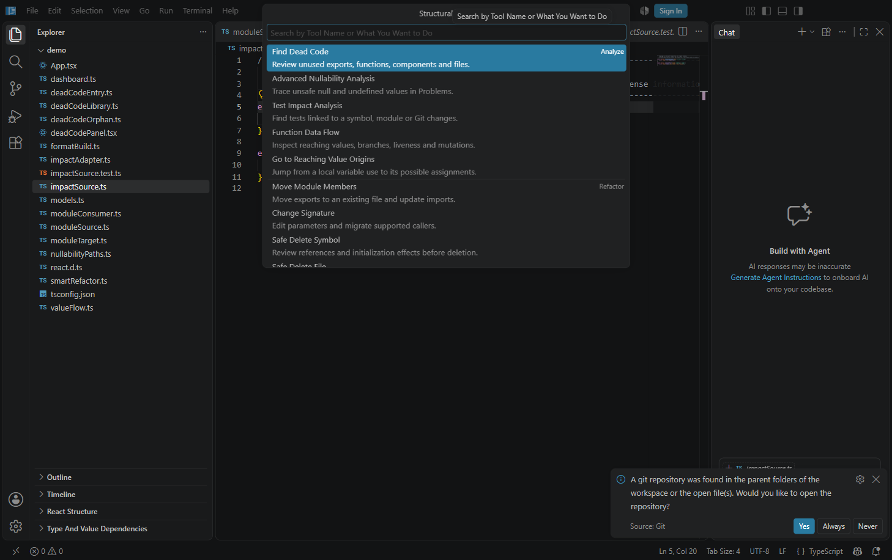
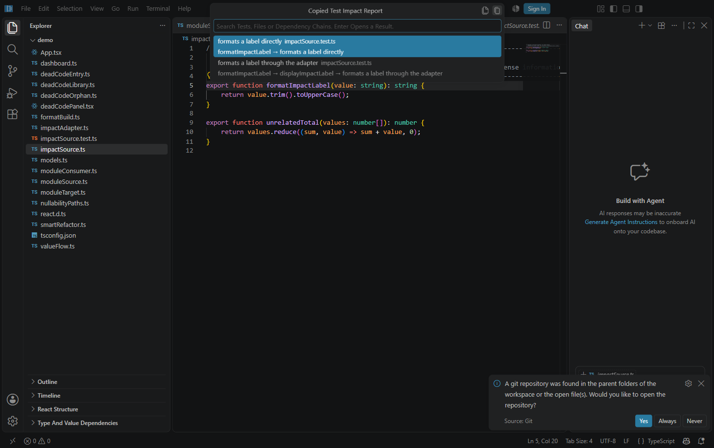
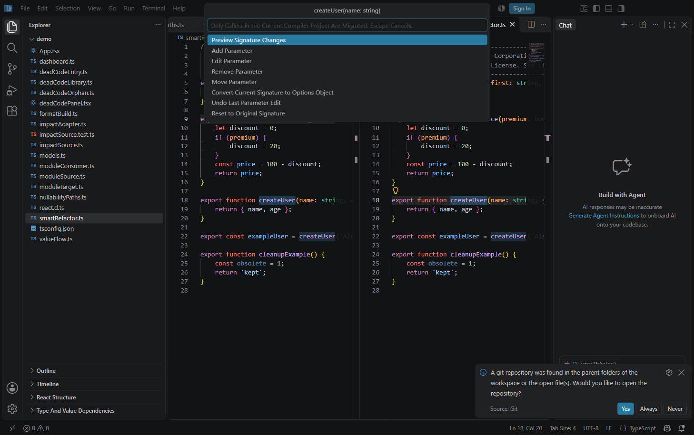
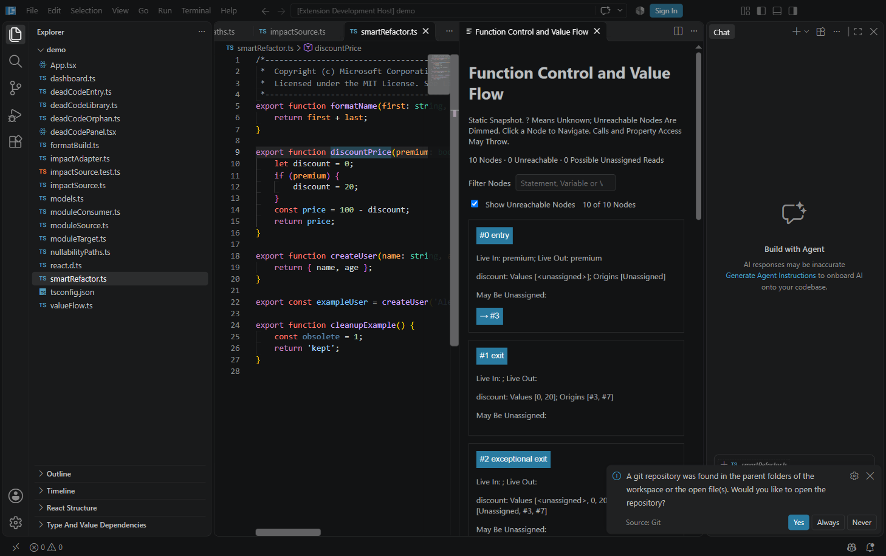

# Everyday Structural Tools

These improvements apply to the eight structural feature areas and keep the existing validation and edit previews in place.

## Find the right tool

Run **TypeScript Structure: Open Structural Tools**. The native picker groups analysis, refactoring and results commands, with a short description of each. Search by a task such as “undefined”, “callers”, “tests” or “delete”. **Advanced Intention Actions** opens refactoring suggestions at the cursor; the normal Ctrl+. shortcut remains available.

## Repeat analysis with less setup

**Find Dead Code** remembers the selected entry files for each compiler project in this workspace. The first run preselects the active source file. Subsequent runs restore surviving entry files; if none remain, the active file is selected again. You can change the checked entries on every run.

**Move Module Members** puts the last validated destination for that source directory first and labels it **Last Destination**. Selecting a destination does not apply edits: review the warning and Refactor Preview as before.

Run **Clear Analysis Results** from the palette or tool picker to clear structural dead-code, nullability and older unused-analysis diagnostics, plus dependency trees. Other extensions' Problems entries remain available. Your saved entry choices are retained.

## Copy affected tests

The Test Impact Analysis result picker has **Copy Affected Test File Paths** and **Copy Impact Report** toolbar buttons. Hover the icons to see their labels. The first copies unique workspace-relative file paths, one per line. The second copies test names, file paths and dependency chains. Both copy the complete analysis result, including entries hidden by a search filter, without closing the picker. The title confirms a successful copy. Enter still opens the selected test after snapshot validation.

## Edit signatures with undo

The Change Signature editor displays original TypeScript types and default expressions in its current-signature title and parameter choices. Displaying an original type does not force every overload to use the implementation's type.

After an edit, choose **Undo Last Parameter Edit** to step back, or **Reset to Original Signature** to restore the starting draft. Reset itself can be undone. The most recent fifty editing steps are retained for that invocation. Nothing changes in source until you preview and approve the refactoring.

Parameter names are checked for syntax and duplicates while typing. Default and caller-migration expressions are checked for expression syntax, and parameter positions are checked against the current list. Compiler validation and caller-effect checks still run when creating the preview.

## Scan deletion blockers quickly

The Safe Delete review starts with counts of blocking references, removable imports and risks. Blocking references come first, followed by removable imports. Each link includes its source line, so you can identify the usage before navigating. Known blockers and initialization effects still prevent deletion.

## Focus the flow view

If the cursor is not on a tracked local variable, Function Data Flow offers a variable picker with declaration line numbers, plus **Whole Function** for a view without a variable overlay. If the cursor already identifies a variable, its values and reaching assignments are shown immediately.

The view summarizes node counts, unreachable nodes and possible unassigned reads. **Filter Nodes** searches the displayed node text, including statements, variables and values. **Show Unreachable Nodes** controls whether dimmed unreachable cards are visible. The live count shows how many cards match; clearing the search restores them. Filtering does not change the compiler analysis or the mutation list. Editing the source still closes its stale flow view.

## Verify the improvements

1. Open the [demo](demo), run **Open Structural Tools**, and search for “undefined”. The nullability tool should remain in the list.
2. Run Find Dead Code with only deadCodeEntry.ts checked. Cancel and reopen the picker from another file in the same project: that entry selection should be restored. Run **Clear Analysis Results** and verify the structural diagnostics disappear.
3. Analyze formatImpactLabel in impactSource.ts. Copy file paths: impactSource.test.ts should appear once despite having two affected cases. Copy the report and check that both dependency chains appear.
4. Run Change Signature on createUser in smartRefactor.ts, remove age from the draft, then undo. Both parameters and their types should return. Add a parameter and try the reserved name “class”: validation should keep the name input open with an error. Escape cancels the draft.
5. Run Function Data Flow on the discountPrice function name. Select discount, search for a nonexistent term, and expect zero visible cards. Clear the search to restore all cards; toggle unreachable-node visibility as needed.
6. Run Safe Delete Symbol on createUser. The report should show its blocking exampleUser caller in the first reference group and refuse deletion.

Validation for this change includes the complete extension suite (153 passing tests), targeted lint, and live checks of the tool picker, clipboard exports, flow filtering and signature editing. See the [full testing walkthrough](README.md) for the underlying feature scenarios.
