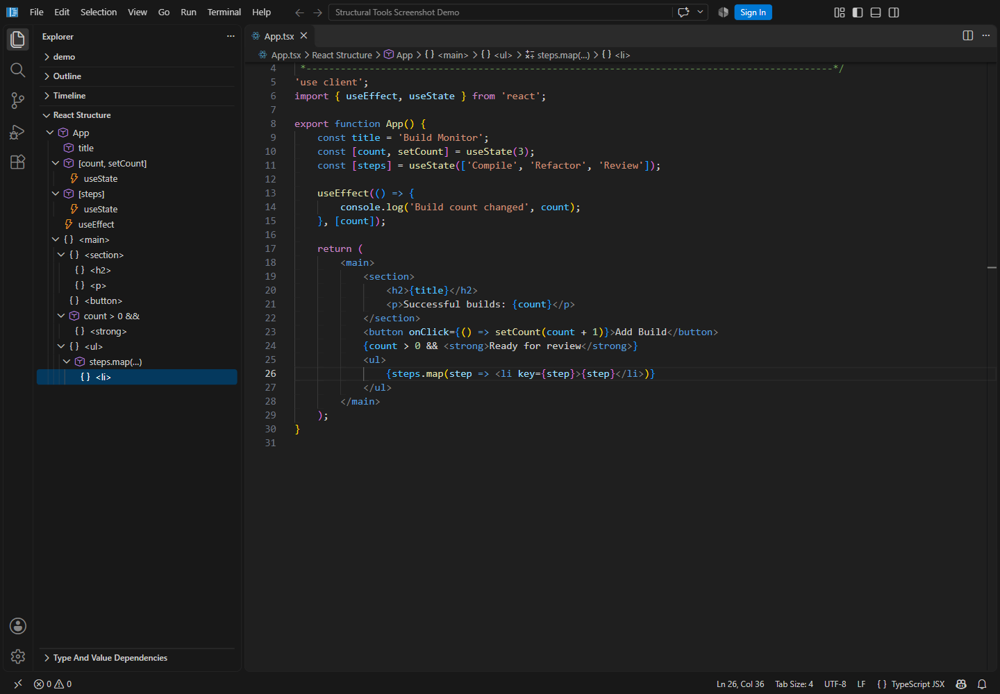
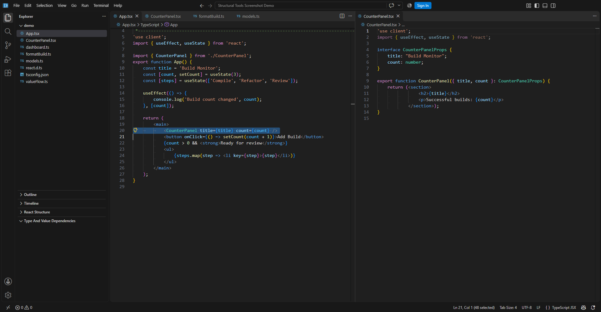
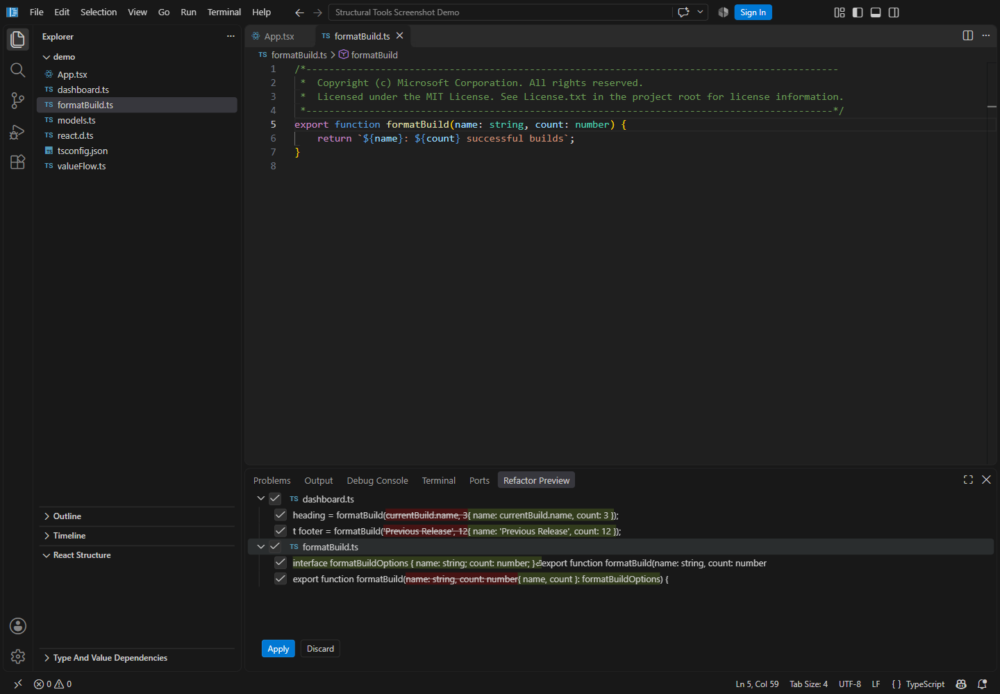
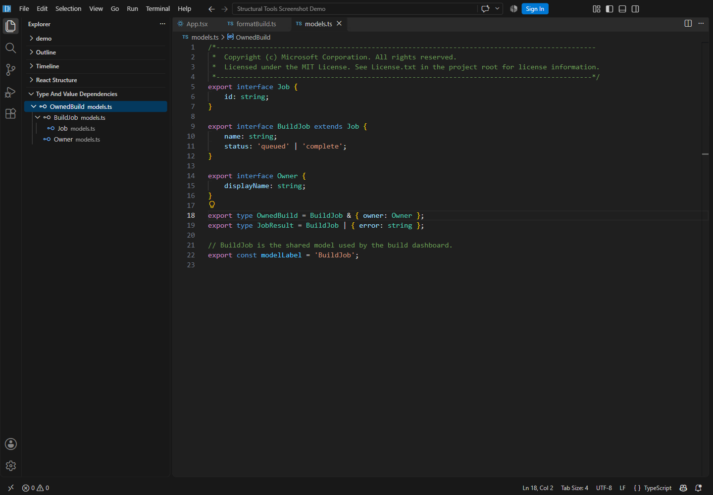
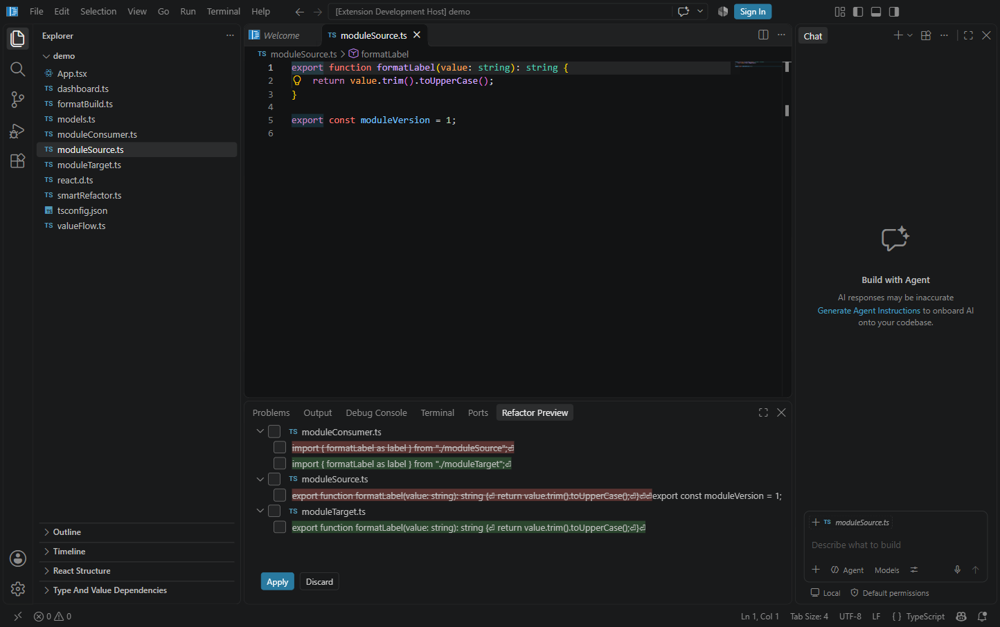
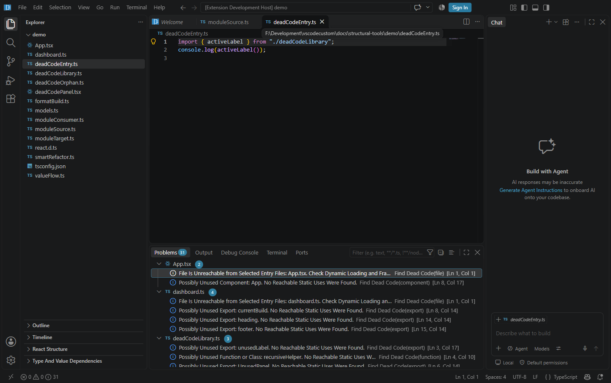
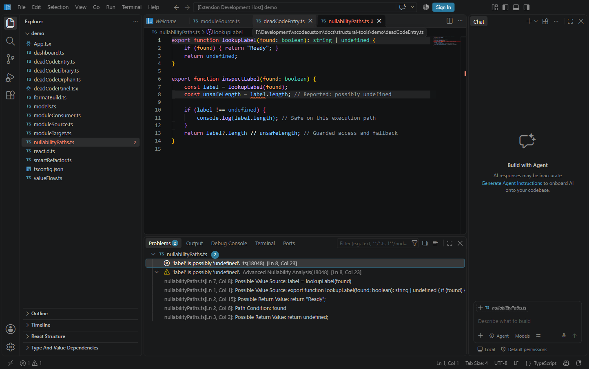
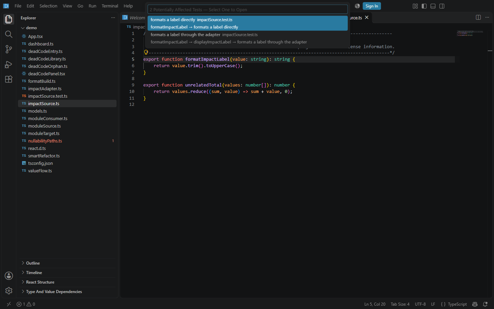

# Testing Structural Tools

These screenshots show the custom Windows Code OSS build with its built-in **TypeScript Structure Tools** extension. They were captured from the running application using an isolated profile and a copy of [demo](demo). The demo is an editing fixture, not a runnable React application; `react.d.ts` supplies small local declarations so no dependency installation is needed.

Copy the demo folder to a writable location and use **File → Open Folder** to open it. Open the Command Palette with `Ctrl+Shift+P`; the commands below start with **TypeScript Structure:**. If asked, trust only a folder whose contents you have reviewed. Run each example on a fresh copy, or discard its preview before continuing. Analysis trees are snapshots: rerun the command after editing.

## 1. JSX structure and breadcrumbs

Open `App.tsx`. Expand **React Structure** in Explorer. Expect `App`, both `useState` hooks, `useEffect`, nested JSX, `count > 0 &&`, and `steps.map(…)`. Click `<li>` to navigate; the breadcrumb includes its JSX and map ancestry. If another document-symbol source is selected, choose **React Structure** as the Outline source.



## 2. Component extraction and rename

In `App.tsx`, select lines 19–22, from `<section>` through `</section>`, then run **Extract React Component**. Enter `CounterPanel`. The preview should create an adjacent `CounterPanel.tsx`, preserve `'use client'`, infer props for `title` and `count`, insert an import, and replace the section with `<CounterPanel title={title} count={count} />`. A literal type for the constant title is expected.

The screenshot shows the result after approving the complete extraction, with the updated source and generated component side by side.



Edits requiring confirmation start unchecked. Check both file groups in **Refactor Preview**, including the new file, then inspect the proposed changes before choosing **Apply**. **Discard** leaves the original files untouched. Approve the whole related change together; partial approval can leave imports, callers, or generated files inconsistent. Extraction copies imports, so **Organize Imports** can remove unused ones afterward.

To test rename on a fresh copy, put the cursor inside the `BuildJob` declaration in `models.ts`. Run **Rename with Text Reference Preview**, enter `BuildTask`, and choose **Symbol, String and Comment References**. Expect semantic references in `models.ts` and `dashboard.ts`, plus the matching comment and `modelLabel` string. **Symbol References** excludes those text matches. **Include Workspace Text Matches in Other File Types** adds heuristic matches outside the compiler program; review them for unrelated words.

## 3. Global refactorings

Open `formatBuild.ts`, click the `formatBuild` identifier, and run **Extract Parameter Object and Update Callers**. Expect `formatBuildOptions`, a destructured parameter, and object arguments for both calls in `dashboard.ts`. Check both file groups, inspect the diffs, then apply or discard.



After applying the complete conversion, run **Inline Parameter Object and Update Callers** inside the function to test the reverse conversion. It requires supported object-literal callers. On a fresh demo, click the `name` member in `BuildJob` and run **Pull Member Up**: the preview moves it to `Job`. After applying that complete change, **Push Member Down** on `Job.name` previews moving it back to the direct child. Review each operation before applying it.

## 4. Type and possible value dependencies

In `models.ts`, click directly inside the **OwnedBuild** identifier, then run **Show Type Dependencies**. Expand `OwnedBuild` and `BuildJob` in **Type and Value Dependencies**. Expect `BuildJob`, `Owner`, and `Job`. Use the expansion arrow; clicking a node's label navigates to its source. Run **Show Type Dependents** on `Job` to explore the reverse direction. The native **Show Type Hierarchy** command supports class/interface inheritance.



Open `valueFlow.ts` and click `validatedCount` in its declaration. Run **Show Possible Value Flow to Here** to inspect its input, or **Show Possible Value Flow from Here** to inspect its uses. Expand nodes as needed. This traces explicit static relationships, not recorded runtime execution. **Analyze Project Types and Unused Declarations** publishes review hints in Problems; a hint alone is not proof that a public API can be removed.

## 5. Move Module Members

Use a fresh demo copy. Open `moduleSource.ts` and put the cursor on the `formatLabel` declaration name. Run **Move Module Members**, choose `moduleTarget.ts` from the existing-file picker, then choose **Review Edits**.

In **Refactor Preview**, expect changes in three files:

| File | Expected change |
| --- | --- |
| `moduleSource.ts` | Removes the exported `formatLabel` function; keeps `moduleVersion`. |
| `moduleTarget.ts` | Adds `formatLabel`; keeps `labelSeparator`. |
| `moduleConsumer.ts` | Changes the import source from `./moduleSource` to `./moduleTarget`, preserving the local alias `label` and its call. |

Check all related file groups and inspect the diffs before applying. After applying, open the destination and consumer to confirm the function and import moved together. On another fresh copy, choose **Discard** instead and verify all three files stay unchanged. You can also select multiple complete top-level exports to move them together. Review module initialization order and consumers outside this compiler project before accepting a real move.



## 6. Find Dead Code

Open `deadCodeEntry.ts` and run **Find Dead Code**. In the multi-select picker, leave only `deadCodeEntry.ts` checked, then press Enter. The selected entry files' exports count as public API; for a real application, select every application, test and framework entry point you want to preserve.

Open **Problems** and inspect entries whose source is **Find Dead Code**. Expect these examples:

| Example | Expected result |
| --- | --- |
| `activeLabel` in `deadCodeLibrary.ts` | No unused warning: the entry file calls it. |
| `unusedLabel` and `recursiveHelper` in `deadCodeLibrary.ts` | Both are candidates; their calls to each other do not make the recursive group reachable. |
| `deadCodeOrphan.ts` | An unreachable-file candidate, plus an unused-export candidate for `abandonedFeature`. |
| `UnusedPanel` in `deadCodePanel.tsx` | A possibly unused JSX component. The same name in `deadCodeLibrary.ts` returns a string and is reported as an export. |

Other demo files can also be reported as unreachable because this run deliberately uses just one entry point. Click a result to navigate. To test refresh behavior, add `unusedLabel` to the entry's import and log its function value with `console.log(unusedLabel)`. Existing analysis results should clear as you edit. Rerun **Find Dead Code** with the same entry selection: `unusedLabel` and `recursiveHelper` should no longer be unused candidates. Restore the fixture afterward.

These are review candidates, not instructions to delete code. Computed imports, reflection, framework discovery and consumers outside the compiler project can hide uses. The command does not delete files or declarations.



## 7. Advanced Nullability Analysis

Open `nullabilityPaths.ts` and run **Advanced Nullability Analysis**. In **Problems**, find the warning with source **Advanced Nullability Analysis** on `label.length` in `const unsafeLength = label.length`. A separate built-in TypeScript error at the same location is expected when strict null checks are already enabled.

Expand the analysis warning. Expect navigable links to the `label = lookupLabel(found)` initializer, the `lookupLabel` function, both possible returns (`"Ready"` and `undefined`), and the `found` path condition. Click the links to verify navigation to those source locations. The `label.length` inside `if (label !== undefined)` and the `label?.length` expression should have no nullability warning.

Replace the unsafe expression with `const unsafeLength = label?.length ?? 0;`. The snapshot results should clear as you edit. Rerun the command and confirm the analysis warning is gone. Restore the fixture before the next test. The command also enables strict null and unchecked-index checks in its own analysis project, so it can report hazards in a project whose normal settings permit them; it does not rewrite `tsconfig.json`.

Source traces list potential origins, bounded to five recursive hops and twenty locations per warning. They do not prove that every listed assignment or return reaches the failing use. Explicit non-null assertions, `any`, inaccurate declarations and runtime mutation can hide hazards.



## 8. Test Impact Analysis

### Function and module scopes

Open `impactSource.ts` and put the cursor on the `formatImpactLabel` declaration name. Run **Test Impact Analysis**, then choose **Function or Symbol at Cursor**. Expect two results:

| Test in `impactSource.test.ts` | Expected reference chain |
| --- | --- |
| `formats a label directly` | `formatImpactLabel → formats a label directly` |
| `formats a label through the adapter` | `formatImpactLabel → displayImpactLabel → formats a label through the adapter` |

The `adds unrelated totals` test should be excluded from this symbol report. Filter the picker by a test title or filename, then select the adapter test. The editor should open its `test("formats a label through the adapter", …)` registration.

Return to `impactSource.ts`, rerun **Test Impact Analysis**, and choose **Active Module**. Expect all three tests, including `adds unrelated totals`: module scope conservatively includes every recognized test in a dependent test file. Each result shows an illustrative dependency chain. The command identifies candidates and navigates to them; it does not execute tests.



### Git-changed modules

Use another fresh demo copy in its own folder, outside an existing repository. Create a clean Git baseline there:

```powershell
git init
git add .
git commit -m "Add structural tools demo"
```

Open that folder in the custom build and ensure its repository appears in Source Control. In `impactSource.ts`, change `formatImpactLabel` from `.toUpperCase()` to `.toLowerCase()` and save. Run **Test Impact Analysis → Git-Changed Modules**. Expect all three tests in `impactSource.test.ts`, because Git scope analyzes changed modules rather than individual changed functions.

Stage only that source change with `git add impactSource.ts` and repeat the command: the staged module should still produce the same candidates. To test unsaved buffers, start from a clean baseline, edit the function without saving, and run Git scope again; the dirty editor buffer should also count as a changed module. Git scope includes staged, unstaged, untracked and merge changes in the active repository. It does not compare previously committed branch changes against another branch.

### Interpreting results

Keep source and tests in the active compiler project. If an application's config excludes tests, open a test file under a config that includes them and select the imported source symbol there. Changed files outside the active project or deleted from it are reported as unanalyzed. If you edit code while the results picker is open, selecting a result should refuse stale navigation and ask you to rerun the analysis.

Conventional test filenames and folders, supported framework imports, literal test titles, imported aliases, suite titles and common `.each(...)` registrations are recognized. Parameterized registrations appear once. Shared setup hooks and test-file initialization conservatively affect all recognized cases in that file. Custom registration wrappers, computed imports, mocks and runtime global effects can require additional tests or broader module analysis; an empty result does not establish that no tests are affected.

## Scope and installation notes

The commands use the active file's nearest TypeScript/JavaScript project, including unsaved documents. Unsupported or ambiguous transformations stop with an explanation. Computed dynamic imports, runtime aliasing, reflection, and unrelated project boundaries are not fully modeled. See the [extension reference](../../extensions/structural-typescript/README.md) for the precise restrictions.

Sections 5–8 require a build or extension package containing the latest additions. An older installed preview may not list these commands. To package the current extension from the repository root, run `node scripts/package-structural-extension.mts`, install the generated VSIX from `.build/releases` using **Extensions: Install from VSIX**, and reload the window. The demo is intended for editing and analysis; Test Impact Analysis does not need a test runner to execute the fixture. Running its Node test examples separately requires an appropriate TypeScript/Node test setup.

The Windows x64 user installer is unsigned. The installer path fix removes an unfiltered duplicate dependency tree that caused `MoveFile failed; code 3` at the default user install path. Packaging now checks path lengths with rename headroom. Native Inno Setup probes covered both fresh copies and overwriting existing files at representative long paths. React Structure remains accessible in Explorer when switching between JSX and other files; an unsupported active file has an empty structure tree.
