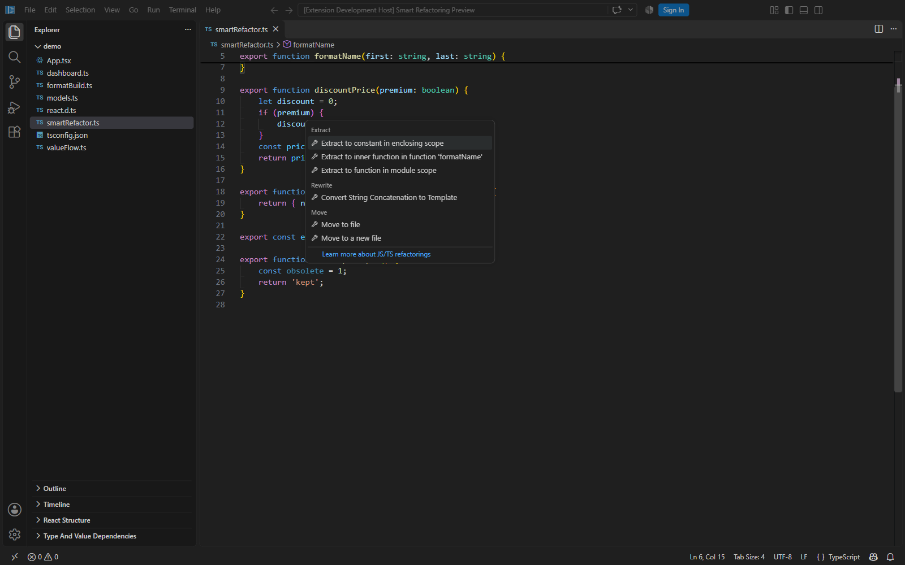
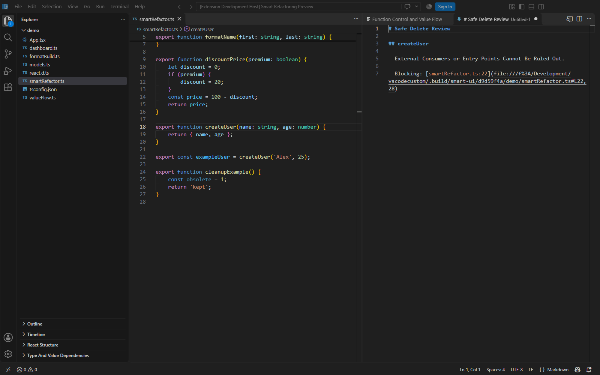
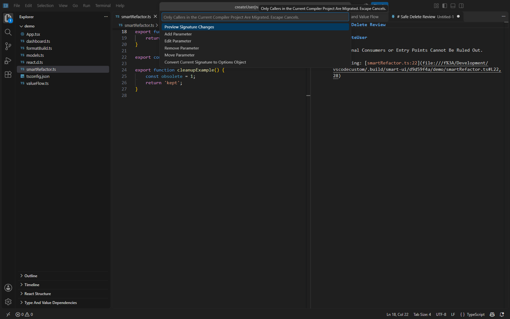

# Smart Refactoring — 0.2.0 testing guide

These additions implement the four feature areas in the project plan using the existing TypeScript compiler service, source snapshots and native edit preview. All examples use a writable copy of the [demo folder](demo), opened as a folder in Code OSS or VS Code with TypeScript Structure Tools 0.2.0 installed. The earlier Windows installer bundles version 0.1.0; install the new VSIX and reload to test these features.

## 1. Advanced Intention Actions

Open `smartRefactor.ts`. Click `first` in `return first + last;`, then press `Ctrl+.`. Choose **Convert String Concatenation to Template**. Review and select the proposed edit before applying it. Expect a template literal preserving the two string operands. Escape or Discard leaves the source unchanged.



The registry has 13 supported transformations, each with positive and rejection tests: if/ternary return conversion in both directions, literal-array accumulation to map, native Promise fulfillment to await, local function expressions to arrows, repeated pure expression extraction, Boolean simplification, nullable receiver guards, guard clauses, string templates, unchanged let to const, local object methods, and optional nullable returns. Unsupported shapes are not suggested. See [scope restrictions](../../extensions/structural-typescript/README.md#advanced-intentions).

## 2. Function Data Flow

In `discountPrice`, click `discount` in `const price = 100 - discount;`. Run **TypeScript Structure: Analyze Function Control and Value Flow**. The side view shows the CFG's nodes and edge destinations. At the return/exit, expect `discount` values `0, 20`, with both the initialization and conditional assignment as origins. Click a node or destination button to navigate to source. **Go to Reaching Value Origins** on the variable use offers those assignments directly.


Supported blocks, branches and loops receive reaching-definition, liveness, constant-set, null-state, possible unassigned-read and unreachable-code analysis. Known property writes and mutating methods are listed. The graph is bounded to 300 nodes and constant sets widen to unknown after eight values. Exceptions are conservative exits. Editing the document closes the graph. Nested functions, destructuring, var declarations, default parameter initializers, try/switch, for-in/of, labels and embedded/conditional assignments are refused explicitly. Heap aliases and arbitrary runtime execution are not modeled.

## 3. Safe Delete

Click the `createUser` declaration and run **TypeScript Structure: Safe Delete Symbol**. Expect a **Blocking** usage at `exampleUser` and an uncertainty warning for external consumers. The command must leave both the function and its call intact.



For a deletion that can proceed, click `obsolete` inside `cleanupExample`. It is an unused local constant with a literal initializer. Review the report, choose **Review Deletion Edits**, approve the target edit in Refactor Preview, and apply it. The return statement must remain. Discarding the preview must keep the constant.

**Safe Delete File** checks known module references and reports external entry-point uncertainty. Known callers block deletion. Public/dynamic risks require deliberate review; initializer effects and unsupported declarations are blocked. Import aliases, type-only cleanup and compatible overload declarations are handled without deleting dependent business logic. A source/configuration change during review invalidates the plan.

## 4. Change Signature

On a fresh sample, click `createUser` and run **TypeScript Structure: Change Signature and Update Callers**. The native editor offers parameter operations and a preview action. Escape cancels the draft.



To reproduce the migration example:

1. Choose **Add Parameter**, enter `email`, choose type `string`, then **Required**.
2. Enter the explicit caller expression `"unknown@example.com"`. This value is provided by you; the engine does not invent it.
3. Choose **Move Parameter**, select `email`, and enter position `2`.
4. Choose **Preview Signature Changes**. Expect `name: string, email: string, age: number` and `createUser('Alex', "unknown@example.com", 25)`.
5. Check the complete file group, review the edits, and Apply or Discard. No edits happen while composing the draft.


The engine supports resolved direct calls across files, compatible overloads with matching parameter counts/names, explicit constructors, and related interface/class methods. Original overload types stay distinct unless overridden. It refuses callback escapes, spreads, optional calls, arguments/generators, reflective calls, incompatible signature families, parameter properties, removed parameters still used by implementations, and argument moves/removals that could reorder or erase effects. JavaScript requires `checkJs`. External consumers are not migrated. **Convert Current Signature to Options Object** reuses the existing bounded conversion command.

## Building and checking

Run from the repository root after installing its dependencies:

```powershell
npm --prefix extensions/structural-typescript test
node scripts/package-structural-extension.mts
node extensions/structural-typescript/test/run-integration.mts "path/to/Code - OSS.exe"
```

The VSIX is written to `.build/releases/structural-typescript-0.2.0.vsix`. Use **Extensions → Install from VSIX**, then reload the window. Its bundle includes TypeScript and the standard library declarations. Screenshots above were taken in an isolated development host running the new extension. Compiler tests cover supported and rejected transformations; real extension-host tests cover registration, lightbulb availability, graph creation, blocked deletion and cancellation. These checks establish the tested scope, not full WebStorm parity or repository-wide runtime equivalence.
